  

  
  
  
  

## 🤖 What I'm building

  

## 🛠️ What I reach for

  
  
  
  
  
   
  
  
  
  
  
   
  
  
  
  
  
   
  
  
  
  

## ✍️ Writing

<table>
  <tr>
    <td width="33%" align="center">
      
       <b>The agent loop</b>
    </td>
    <td width="33%" align="center">
      
       <b>Barge-in in voice agents</b>
    </td>
    <td width="33%" align="center">
      
       <b>AI agent memory</b>
    </td>
  </tr>
  <tr>
    <td width="33%" align="center">
      
       <b>Agentic RAG</b>
    </td>
    <td width="33%" align="center">
      
       <b>KV cache in LLMs</b>
    </td>
    <td width="33%" align="center">
      
       <b>Prompt Injection in LLMs</b>
    </td>
  </tr>
</table>

  

## 🧭 Journey

  

